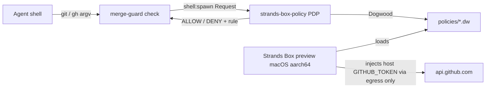

# minilab-box-contain-merge

**Built by SkilledDragon LLC — architecture-led software engineering — skilleddragon.com**

Palette: `#020617` / `#040F49` / `#006BDF` / `#00BFA6`

> **Preview caveat:** Strands Box local sandbox execution is a preview supported on macOS Apple silicon only today; Linux support is planned. Linux CI runs the upstream unit tests with the namespace skips listed in RESULTS.md; the live sandbox demo runs on macOS Apple silicon (`macos-15`).

## 1. What we built

`minilab-box-contain-merge` is a Rust workspace that ships a Dogwood policy pack and a `merge-guard` CLI. The CLI proves that an agent governed by Strands Box + Dogwood cannot run `git push`, `git merge`, or `gh pr merge` until a policy file grants it. Según Anthropic ([Redesigning source control](https://www.anthropic.com/engineering/redesigning-source-control)), engineers' job is often to tell Claude "no"; Box makes that "no" an OS-level default. Scion is internal and not for general use — this lab uses the public Strands Box pin instead.

## 2. What we tested

- Upstream pin `223e3959d539110eaacfacb6f973c03928dc39b0`: verbatim `rust-test-lint.yml` steps (unit-test on ubuntu + macos advisory, plus lint), called the same way upstream's `ci.yml` `rust` job calls it, plus `detect-changes` with `upstream/` prefixes. Jobs `containment`, `verdict`, and upstream `ci-gate` are not run (out of lab scope) — see RESULTS.md.
- Lab: `cargo test --workspace --locked` (table-driven ≥20 commands, policy parse, `GITHUB_TOKEN` stripped from guarded env, macOS aarch64 live deny test).
- Fill RESULTS.md with pass counts, durations, and the CI run URL after the green push.

## 3. Setup

```sh
git clone --recurse-submodules https://github.com/SkilledDragonCorp/minilab-box-contain-merge.git
cd minilab-box-contain-merge
git -C upstream rev-parse HEAD
# must print 223e3959d539110eaacfacb6f973c03928dc39b0
cp .env.example .env
cargo test --workspace --locked
cargo run -p xtask --locked -- extract-upstream
bash scripts/upstream-test.sh
```

### Tutorial

```sh
cargo run -p merge-guard --locked -- check --policy policies/merge-locked.dw -- git status
# ALLOW rule=git_status command=git status

cargo run -p merge-guard --locked -- check --policy policies/merge-locked.dw -- git push origin main
# DENY rule=forbid_git_push command=git push origin main
# exit code 1

cargo run -p merge-guard --locked -- check --policy policies/merge-unlocked.dw -- git push origin feature/x
# ALLOW rule=git_push_non_main command=git push origin feature/x

cargo run -p merge-guard --locked -- check --policy policies/merge-unlocked.dw -- git push origin main
# DENY rule=forbid_git_push_main command=git push origin main
```

On screen during any live demo, restate the preview caveat above.

### Architecture



## 4. Using these skills in Claude Code and Cursor

- Claude Code auto-discovers `.claude/skills/<name>/SKILL.md`.
- Cursor loads the same `.claude/skills` folder (no `.cursor/skills` mirror).
- Invoke by name: **authoring-merge-policy** — author or extend a Dogwood merge policy and verify with:

```sh
cargo run -p merge-guard --locked -- check --policy policies/merge-locked.dw -- git status
```

## 5. API keys

| Env var | Required | Where to get it | Needed by |
|---|---|---|---|
| `GITHUB_TOKEN` | optional | GitHub → Settings → Developer settings → Personal access tokens | macOS live Box demo egress only |
| `CARGO_TERM_COLOR` | optional | set to `always` | CI / local cargo logs |
| `RUSTFLAGS` | optional | set to `-C debuginfo=0` | CI disk / parity with upstream |
| `OTEL_SDK_DISABLED` | optional | set to `true` | telemetry opt-out |
| `OTEL_TRACES_EXPORTER` | optional | set to `none` | telemetry opt-out |
| `OTEL_METRICS_EXPORTER` | optional | set to `none` | telemetry opt-out |
| `OTEL_LOGS_EXPORTER` | optional | set to `none` | telemetry opt-out |

Box owns names beginning with `OTEL_EXPORTER_OTLP_` (see upstream `docs/user/telemetry.md`). Lab demos set `OTEL_*_EXPORTER=none` and `OTEL_SDK_DISABLED=true` so strands-box-telemetry stays quiet. Mirror names in `.env.example`.

## 6. License

- This lab: MIT (see `LICENSE`).
- Upstream Strands Box at pin `223e3959d539110eaacfacb6f973c03928dc39b0`: Apache-2.0 — https://github.com/strands-agents/box
